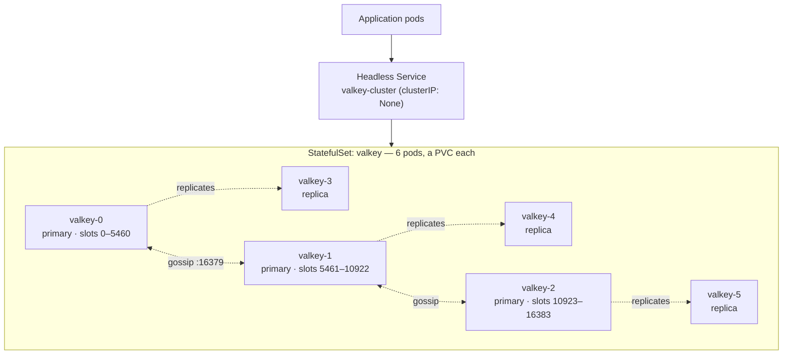

# Way 1 — Raw manifests

Deploy a 6-node **Valkey cluster** (3 primaries + 3 replicas) on Kubernetes with plain
manifests — no Helm, no operator. You author every object yourself, then form the cluster
by hand.

> Companion to the talk **"Building a Kubernetes Operator for Valkey: Lessons from Running
> It in Production"** (KCD Buenos Aires 2026). The manual path here is adapted from
> Roberto's *"Three Ways to Deploy a Cache on Kubernetes"* (CNCF CDMX).

## Architecture



- **16,384 hash slots** distributed across the 3 primaries.
- Each primary has 1 replica; nodes discover each other over the **gossip** bus (:16379).
- Auto-failover promotes a replica if a primary is lost.

## What you deploy (5 pieces)

| # | Object | Job |
|---|--------|-----|
| 1 | **ConfigMap** (`01-configmap.yaml`) | `valkey.conf` — cluster mode, persistence |
| 2 | **Headless Service** (`02-service.yaml`) | stable per-pod DNS (`clusterIP: None`) |
| 3 | **StatefulSet** (`03-statefulset.yaml`) | 6 pods (`valkey-0..5`) + a PVC each |
| 4 | **PodDisruptionBudget** (`04-pdb.yaml`) | `minAvailable: 4` for safe upgrades |
| 5 | **Cluster init** (`init-cluster.sh`) | `valkey-cli --cluster create` (3P + 3R) |

## Deploy

```bash
# 1. apply the manifests
kubectl apply -f manifests/

# 2. once the 6 pods are up, form the cluster
./init-cluster.sh
```

## Verify

```bash
kubectl -n valkey-demo exec valkey-0 -- valkey-cli cluster info
# cluster_state:ok
# cluster_slots_assigned:16384
# cluster_known_nodes:6
```

## Tear down

```bash
kubectl delete namespace valkey-demo
```

## The catch

You own **every** object *and* the cluster-forming script — plus upgrades, scaling,
resharding, and failover glue. That's the motivation for the next two ways
([Helm](../helm), [operator](../operator)).
